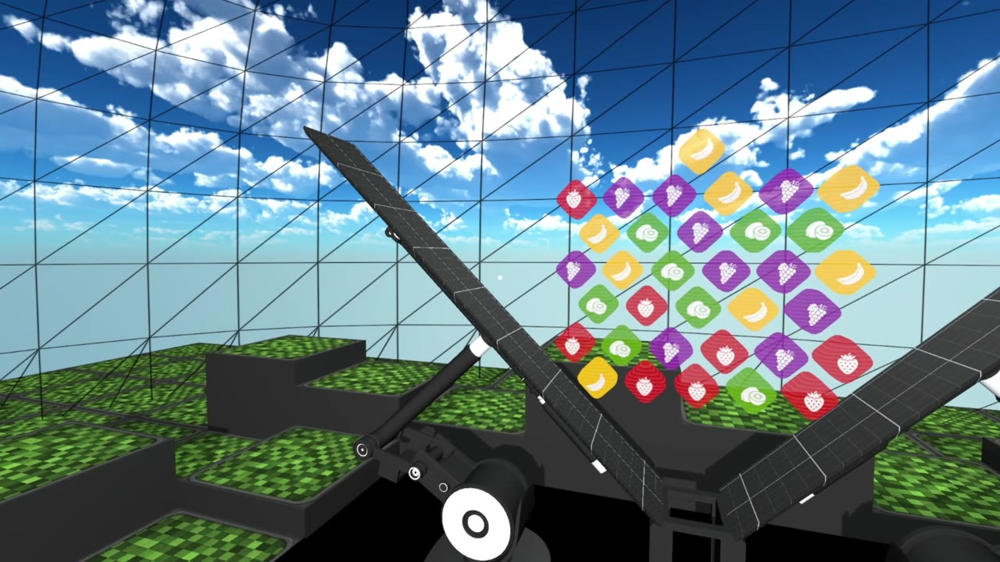
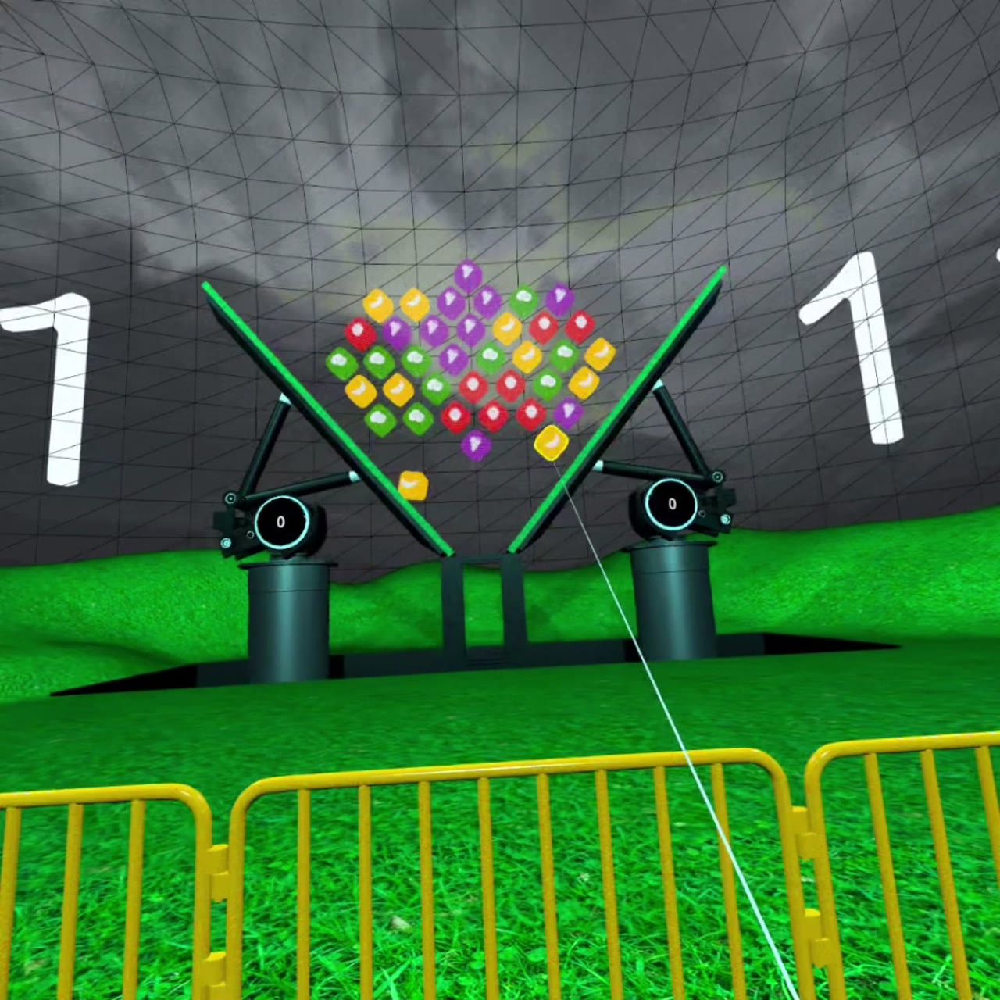

# FruitLab

FruitLab — VR-головоломка, созданная в рамках Всероссийского «Varwin Хакатона 2026». Проект стал финалистом номинации «VR Яндекс Игры».

[Страница проекта на Varwin Education](https://varwin.com/ru/education/project/fruitlab) · [Видео геймплея](media/gameplay-silent.mp4)

**[Скачать игру и проект Varwin](https://github.com/kryukovilya/FruitLab/releases/latest)**

В релизе находятся `FruitLab.exe` для Windows x64 и `FruitLab.vwp` для редактирования в Varwin XRMS. Исходная версия проекта — **18.2.170**. [Инструкция запуска и импорта](docs/RUNNING.md).

Проект команды **«Гномы»**. **Илья Крюков — тимлид**. Состав команды и наставник указаны на [официальной странице проекта](https://varwin.com/ru/education/project/fruitlab).



## Игровой процесс

Игрок взаимодействует с фруктовыми кубиками в виртуальной реальности и собирает одинаковые пары в приёмной зоне. Совпавшие кубики исчезают, освобождая место. Цель — убрать все кубики и перейти к следующему раунду. Если зона переполнена, игра заканчивается.

Анимации, звуковые эффекты и счётчики сопровождают действия игрока и показывают результат.

## Режимы

- **Классический** — подбор пар, набор очков и прохождение раундов.
- **На время** — ограниченный запас времени, бонусные секунды за пары и завершённые раунды. Дополнительная механика позволяет удалить кубики случайно выбранного типа.

Стартовая сцена объединяет вступление и выбор режима.



## Технологии

- **Varwin и Blockly** — логика сцен, игровые события и переходы между режимами.
- **Unity и C#** — компоненты объектов, физика, столкновения и триггеры.
- **Animator** — анимации объектов и окружения.
- **MaterialPropertyBlock** — управление параметрами материалов.

## Структура

```text
src/Objects/       C#-компоненты, prefab и настройки объектов
src/scene-logic/   логика сцен и привязки объектов Varwin
media/            скриншоты и видео геймплея
docs/             описание устройства игры
distribution/     описание экспорта и дополнительные ресурсы проекта
scripts/          подготовка проверенного дистрибутива
```

[Подробнее об устройстве игры](docs/ARCHITECTURE.md)

Репозиторий содержит C#-код объектов, prefab и логику сцен. Полный экспорт Varwin доступен отдельным файлом в релизе. Самостоятельного Unity-проекта и исходных файлов шейдеров в доступных материалах нет; готовые ресурсы находятся внутри пакетов Varwin.
